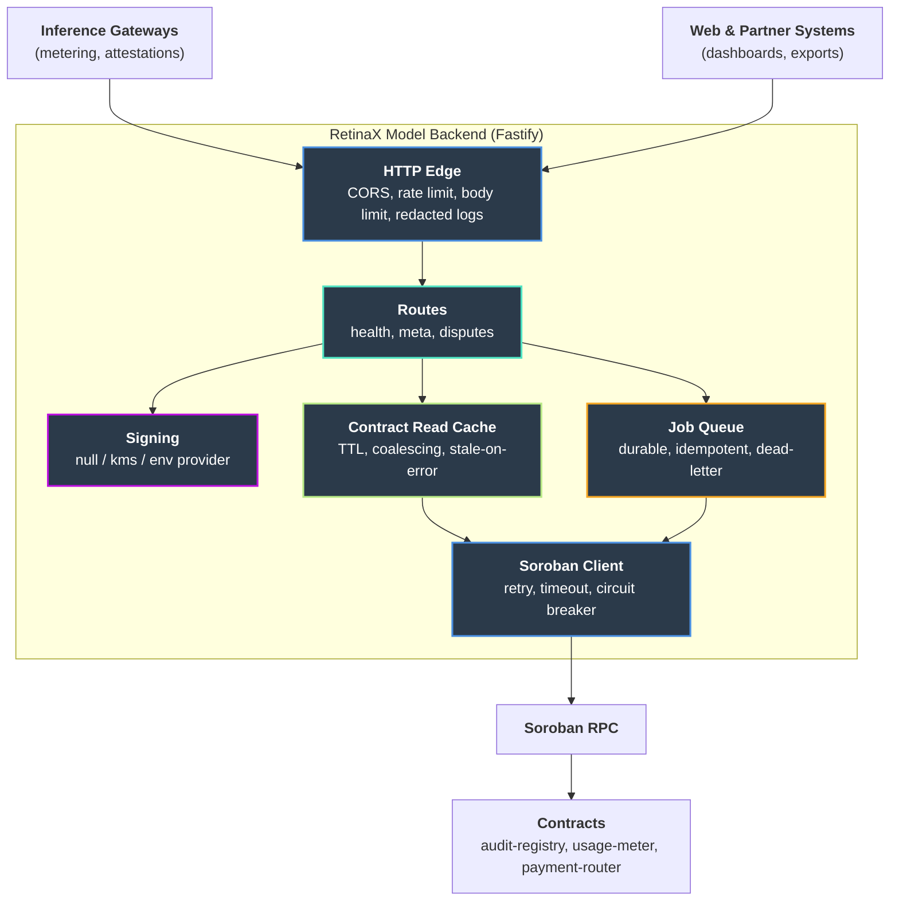

# RetinaX Model Backend - Trusted API Edge for AI Audit Trails on Stellar

[](https://nodejs.org/)
[](https://fastify.dev/)
[](https://www.typescriptlang.org/)
[](https://soroban.stellar.org/)
[](LICENSE)
[](https://github.com/RetinaX-Org/RetinaX-model-backend/actions)

RetinaX Model Backend is the integration and policy edge for the [RetinaX Model](https://github.com/RetinaX-Org/retinaX-model) protocol. It is a Fastify service written in TypeScript that sits between AI inference gateways and the Soroban contracts (`audit-registry`, `usage-meter`, `payment-router`). The contracts hold the rules and the truth on-chain. This service decides who may invoke what, when, and with which credentials. Built for inference vendors, enterprises that need tamper-evident exports, and operators who cannot put RPC secrets or signing keys in a browser.

The service handles what contracts cannot safely hold: RPC URLs, signing keys, vendor tokens, scheduled work and bulk exports. It validates quota, prepares chain-facing work, and keeps custody boundaries explicit so that a compromise of the API cannot move funds.

---

## Table of Contents

- [Project Overview](#project-overview)
- [Setup Instructions](#setup-instructions)
  - [Prerequisites](#prerequisites)
  - [Quick Start](#quick-start)
  - [Environment Variables](#environment-variables)
  - [Running Tests](#running-tests)
- [Features](#features)
- [Architecture](#architecture)
- [Project Structure](#project-structure)
- [HTTP API](#http-api)
- [Usage Examples](#usage-examples)
- [Deployment](#deployment)
- [CI/CD Pipeline](#cicd-pipeline)
- [Roadmap](#roadmap)
- [Helpful Links](#helpful-links)
- [Contribution Guidelines](#contribution-guidelines)
- [License](#license)
- [Support](#support)

---

## Project Overview

AI procurement is scaling faster than governance. Teams cannot consistently prove model version, region or policy for a given output, and usage-based billing for inference lacks a shared neutral layer, which leads to disputes between buyers and providers. The on-chain contracts fix the record. This backend connects existing inference gateways and enterprise systems to that record without exposing secrets to the client.

### Key Benefits

| Benefit | Description |
|---------|-------------|
| **Secrets Stay Server-Side** | RPC URLs, signing keys and vendor tokens never reach the browser |
| **Explicit Key Custody** | Value movement is returned unsigned; only a scoped attestation key may exist ([ADR 0001](docs/adr/0001-soroban-signing-key-custody.md)) |
| **Resilient Chain Access** | Retry with jitter, timeouts and a circuit breaker around Soroban RPC |
| **Honest Billing Reads** | Cached contract reads always carry an as-of timestamp and a stale flag ([ADR 0002](docs/adr/0002-contract-read-caching.md)) |
| **Fail-Fast Configuration** | Invalid environment stops startup with a readable, value-free error |

### Target Users

- Inference vendors and gateway operators
- Enterprises and procurement teams needing audit exports
- Independent auditors and compliance teams
- Developers integrating metering and settlement into existing systems

---

## Setup Instructions

### Prerequisites

- **Node.js 20.x or 22.x** (LTS) - [Install Node.js](https://nodejs.org/)
- **npm** - bundled with Node.js
- **Git** - for version control

### Quick Start

```bash
# Clone the repository
git clone https://github.com/RetinaX-Org/RetinaX-model-backend.git
cd RetinaX-model-backend

# Install dependencies
npm ci

# Configure the environment
cp .env.example .env

# Start the dev server with reload
npm run dev
```

The API listens on **http://localhost:8080**. Check it with `GET /health` and `GET /api/v1/meta`.

To run it alongside a web frontend, start the API, then start the frontend separately and set `CORS_ORIGIN` in `.env` to the frontend origin (for example `http://localhost:3000`).

### Environment Variables

Configuration is parsed and validated with Zod in `src/config/env.ts`. See `.env.example` for a working starting point. Never commit secrets.

| Variable | Default | Purpose |
|----------|---------|---------|
| `NODE_ENV` | `development` | Environment name |
| `PORT` | `8080` | Listen port |
| `API_PREFIX` | `/api/v1` | Prefix for versioned routes |
| `CORS_ORIGIN` | dev: `http://localhost:3000` | Comma-separated allowed origins. **Required in production**; `*` is rejected |
| `STELLAR_NETWORK` | required | `testnet`, `futurenet` or `mainnet` |
| `SOROBAN_RPC_URL` | required | Soroban RPC endpoint (server-side only) |
| `AUDIT_REGISTRY_CONTRACT_ID` | required | `audit-registry` contract ID |
| `USAGE_METER_CONTRACT_ID` | required | `usage-meter` contract ID |
| `PAYMENT_ROUTER_CONTRACT_ID` | required | `payment-router` contract ID |
| `SIGNING_PROVIDER` | `null` | `null`, `kms` or `env`. `env` is refused when `NODE_ENV=production` |
| `SIGNING_KMS_KEY_ID` | - | KMS key reference when `SIGNING_PROVIDER=kms` |
| `SIGNING_ENV_SECRET_KEY` | - | Local development only; never an account that holds funds |
| `RATE_LIMIT_MAX` | `100` | Requests allowed per window, per IP |
| `RATE_LIMIT_WINDOW_MS` | `60000` | Rate-limit window in milliseconds |
| `BODY_LIMIT_BYTES` | `1048576` | Maximum request body size |
| `BUILD_SHA`, `BUILD_TIME` | `unknown` | Injected by CI; reported by `GET /api/v1/meta` |

### Running Tests

```bash
# Typecheck
npm run lint

# Build and run all tests (node:test on compiled output)
npm test
```

### Scripts

| Command | Purpose |
|---------|---------|
| `npm run dev` | `tsx watch` with reload on change |
| `npm run build` | Compile to `dist/` |
| `npm start` | Run the compiled server |
| `npm run lint` | `tsc --noEmit` typecheck |
| `npm test` | Build, then run every `*.test.js` |

---

## Features

- Fastify 5 server, strict TypeScript, ESM
- Zod-validated configuration that fails fast with a readable error
- Fail-closed CORS in production
- Rate limiting and request body size limits
- Secret redaction at the logger boundary (headers, query strings and errors)
- Custody-aware signing provider with `null`, `kms` and `env` modes
- Resilient Soroban RPC client: retry with full jitter, per-call timeouts, circuit breaker, no blind resubmission
- Read-through contract cache with per-type TTLs, request coalescing, invalidation and labelled stale-on-error
- Durable background job queue with backoff, dead-letter handling and metrics
- Dispute management with role-scoped access, evidence hashing and a closing window
- Liveness and readiness health checks with cached RPC probing and shutdown awareness

---

## Architecture



### Contract Responsibilities

| Contract | What the API does |
|----------|-------------------|
| `audit-registry` | Receives signed inference payloads from trusted gateways, validates the schema, forwards to the simulate and submit pipeline |
| `usage-meter` | Aggregates billable units server-side and syncs quota state with contract reads |
| `payment-router` | Prepares unsigned payout and dispute transactions and reconciles off-chain invoices with escrow releases |

---

## Project Structure

```
RetinaX-model-backend/
│
├── src/
│   ├── index.ts                # Fastify bootstrap, logging, CORS, rate limit, routes
│   ├── config/                 # Zod environment parsing and redacted config
│   ├── core/
│   │   ├── signing/            # Key custody providers and secret redaction
│   │   └── contract-read/      # TTL cache for contract reads
│   ├── soroban/                # RPC client, retry, timeout, circuit breaker, errors
│   ├── queue/                  # Durable job queue and file-backed store
│   ├── meta/                   # Version and build info for /meta
│   └── routes/
│       ├── health.ts           # Liveness and readiness
│       ├── v1/                 # Versioned API surface
│       └── disputes/           # Dispute lifecycle routes and store
│
├── docs/adr/                   # Architecture decision records
├── .github/                    # CI, Dependabot, issue and PR templates
├── .env.example                # Environment template
├── package.json
├── tsconfig.json
└── README.md                   # This file
```

---

## HTTP API

### Implemented

| Method | Path | Description |
|--------|------|-------------|
| GET | `/health`, `/health/live` | Liveness |
| GET | `/health/ready` | Readiness: Soroban RPC reachability (cached 5s), 503 when unhealthy or shutting down |
| GET | `{API_PREFIX}/meta` | Name, version, build info, network and contract IDs |
| POST | `{API_PREFIX}/disputes` | Raise a dispute |
| GET | `{API_PREFIX}/disputes` | List disputes visible to the caller's role |
| POST | `{API_PREFIX}/disputes/:id/evidence` | Add evidence while the window is open |
| POST | `{API_PREFIX}/disputes/:id/resolve` | Resolve a dispute (adjudicator only) |

> Dispute routes currently read `x-role` and `x-user-id` headers as a placeholder for a real identity layer. Do not expose them publicly until authentication is in place.

### Planned

- `POST /api/v1/meter/events` - idempotent usage rows from inference gateways
- `POST /api/v1/settlement/simulate` - dry-run Soroban footprint before submit
- `GET /api/v1/audit/export/:jobId` - poll async compliance export jobs
- `POST /api/v1/webhooks/register` - outbound delivery for billing systems

---

## Usage Examples

### Check Service Status

```bash
curl http://localhost:8080/health/ready
curl http://localhost:8080/api/v1/meta
```

### Raise and Resolve a Dispute

```bash
# Buyer raises a dispute
curl -X POST http://localhost:8080/api/v1/disputes \
  -H 'content-type: application/json' \
  -H 'x-role: buyer' -H 'x-user-id: buyer-1' \
  -d '{"settlementId":"s-1","reason":"overbilled","buyerId":"buyer-1","sellerId":"seller-1"}'

# Adjudicator resolves it
curl -X POST http://localhost:8080/api/v1/disputes/<id>/resolve \
  -H 'content-type: application/json' \
  -H 'x-role: adjudicator' -H 'x-user-id: adj-1' \
  -d '{"outcome":"split","notes":"partial refund"}'
```

### Read a Contract Value Through the Cache

```ts
const metadataCache = createContractReadCache<ContractMetadata>(
  ContractReadType.Metadata,
  { onEvent: (event, detail) => app.log.info({ event, ...detail }, event) },
);

const { value, asOf, stale } = await metadataCache.read(
  `metadata:${contractId}`,
  () => rpc.readContractMetadata(contractId),
);
```

### Run Work on the Queue

```ts
const queue = new JobQueue({ filePath: "./data/jobs.json" });
queue.registerHandler("submit-tx", async (payload) => { /* ... */ });

const job = queue.enqueue("submit-tx", payload, { id: "tx-123" });
await queue.run(job.id);
```

---

## Deployment

- Run behind TLS termination (load balancer or reverse proxy).
- Set `NODE_ENV=production` and an explicit, non-wildcard `CORS_ORIGIN`.
- Use `SIGNING_PROVIDER=kms` or leave it as `null`. `env` is refused in production.
- Store signing keys in KMS or HSM, never in the repository.
- Restrict Soroban RPC by IP allowlist or a private gateway where possible.
- Inject `BUILD_SHA` and `BUILD_TIME` at build time; the container has no `.git` directory.
- Send structured JSON logs with request IDs to your log pipeline.

```bash
npm ci
npm run build
npm start
```

---

## CI/CD Pipeline

### GitHub Actions Workflows

| Workflow | Trigger | Purpose |
|----------|---------|---------|
| `ci.yml` | Push/PR to `main` | Install, typecheck, build, test and `npm audit` (high severity gate) |

Actions are pinned to commit SHAs and Dependabot keeps dependencies and workflows current.

---

## Roadmap

- [x] Config validation, CORS and operational guardrails
- [x] Signing key custody policy and provider interface
- [x] Soroban RPC client with retry, timeout and circuit breaking
- [x] Contract read cache and durable job queue
- [x] Health checks and dispute routes
- [ ] Gateway and operator authentication
- [ ] Usage ingestion and settlement simulation endpoints
- [ ] KMS-backed attestation signing
- [ ] Async audit export jobs and webhooks
- [ ] Persistent storage for disputes

---

## Helpful Links

### Documentation

- [ADR 0001 - Signing key custody](docs/adr/0001-soroban-signing-key-custody.md)
- [ADR 0002 - Contract read caching](docs/adr/0002-contract-read-caching.md)

### Repository Resources

- [Contributing Guide](CONTRIBUTING.md)
- [Code of Conduct](CODE_OF_CONDUCT.md)
- [Security Policy](SECURITY.md)

### Related Projects

- [RetinaX Model](https://github.com/RetinaX-Org/retinaX-model) - contracts, SDK and dashboard
- [RetinaX](https://github.com/RetinaX-Org/RetinaX) - vision care records on Stellar

### External Resources

- [Stellar Developer Docs](https://developers.stellar.org/)
- [Soroban Documentation](https://soroban.stellar.org/docs)
- [Fastify Documentation](https://fastify.dev/docs/latest/)

---

## Contribution Guidelines

We welcome contributions! See [CONTRIBUTING.md](CONTRIBUTING.md) for the review bar.

### Getting Started

1. **Fork** the repository
2. **Clone** your fork locally
3. **Create** a feature branch: `git checkout -b feature/your-feature`
4. **Make** your changes
5. **Test** your changes: `npm run lint && npm test`
6. **Commit** with a Conventional Commits message
7. **Push** to your fork
8. **Submit** a Pull Request

### Code Standards

- Validate every input at the boundary with Zod
- No secrets in responses, logs or errors
- Typed, mapped errors; no swallowed failures
- Chain-writing paths must be idempotent
- Write tests for new functionality

### Definition of Done

- [ ] Typecheck and build pass
- [ ] All tests pass
- [ ] Documentation updated
- [ ] PR description is complete
- [ ] Linked to relevant issue

---

## License

This project is licensed under the Apache License 2.0 - see the [LICENSE](LICENSE) file for details.

---

## Support

- **Issues**: [GitHub Issues](https://github.com/RetinaX-Org/RetinaX-model-backend/issues)
- **Discussions**: [GitHub Discussions](https://github.com/RetinaX-Org/RetinaX-model-backend/discussions)
- **Security**: see [SECURITY.md](SECURITY.md)

---

<p align="center">
  Built with ❤️ on Stellar
</p>
